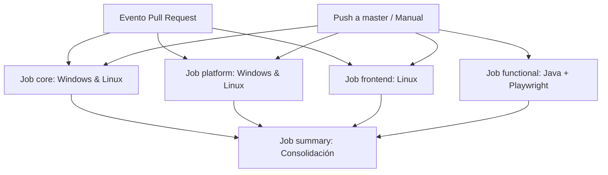

# Guía de Integración Continua en GitHub Actions (`docs/qa-ci.md`)

Este documento detalla la arquitectura, configuración, políticas de seguridad y procedimientos operativos de los workflows de Integración Continua (CI) del Agente de QA en GitHub Actions.

---

## 1. Arquitectura de Workflows

El repositorio define dos flujos de trabajo claramente segregados en `.github/workflows/`:

| Archivo | Eventos Desencadenantes | Propósito y Alcance | Entorno y Secretos |
| :--- | :--- | :--- | :--- |
| **`qa.yml`** | `pull_request` (hacia `master`), `push` (en `master`), `workflow_dispatch` | Pipeline continuo ordinario y completo. Ejecuta suites Python (core), microservicios HTTP reales (platform), React/Vitest (frontend) y validación Quarkus/Playwright (functional). | **Cero secretos**. Permisos mínimos `contents: read`. 100% determinista y offline. |
| **`qa-llm-live.yml`** | Exclusivamente `workflow_dispatch` (manual) | Verificación manual contra proveedores LLM reales (`gemini`, `openai`, `deepseek`) y análisis post-ejecución opcional. | Environment protegido `qa-live` con secretos de API (`GEMINI_API_KEY`, `OPENAI_API_KEY`, `DEEPSEEK_API_KEY`). |

---

## 2. Matriz de Entornos y Versiones Fijadas

Para garantizar máxima reproducibilidad y evitar roturas por actualizaciones de herramientas en runners alojados:

- **Sistemas Operativos**: `ubuntu-latest` y `windows-latest`.
- **Acciones Oficiales**: Todas las acciones oficiales se fijan mediante **commit SHAs inmutables de 40 caracteres hexadecimales** con comentarios de versión semántica:
  - `actions/checkout@11bd71901bbe5b1630ceea73d27597364c9af683` (v4.2.2)
  - `actions/setup-python@42375524e23c412d93fb67b49958b491fce71c38` (v5.4.0)
  - `actions/setup-node@1e60f620b9541d16abce96c54a30e55b911a0849` (v4.2.0)
  - `actions/setup-java@3a4f6e1af504cf6a31855fa899c6aa5355ba6c12` (v4.7.0)
  - `actions/cache@d4323d4df104b026a6aa633fdb11d772146be0bf` (v4.2.2)
  - `actions/upload-artifact@4cec3d8aa04e39d1a68397de0c4cd6fb9dce8ec1` (v4.6.1)
- **Runtimes y Compiladores**:
  - **Python**: `3.12` fijado como versión de referencia.
  - **Node.js**: `22` fijado para Vitest, build Vite y Playwright.
  - **Java**: `21` (distribución `temurin`).
  - **Maven**: 3.9.x administrado con cache local `~/.m2/repository`.

---

## 3. Estructura de Jobs en `qa.yml`



### Detalle de Jobs:

1. **`core`** (Windows y Linux):
   - Verifica el entorno con `python scripts/qa.py doctor`.
   - Ejecuta la suite de pruebas unitarias y de integración del producto (`tests/`) mediante `python scripts/qa.py run --suite python`.
   - Ejecuta las pruebas contractuales del Agente de QA (`pytest qa_tests/test_delivery_contracts_d01_d02.py ...`).
   - Sube reportes y artefactos con `always()`.
2. **`platform`** (Windows y Linux):
   - Levanta los 5 microservicios FastAPI reales del producto sobre sockets loopback efímeros.
   - Ejecuta `python scripts/qa.py run --suite platform`.
   - **Manejo honesto del fallo conocido**: El defecto de persistencia conocido del producto no se oculta ni se disfraza con `continue-on-error`. El exit code real se propaga y la evidencia diagnóstica completa se preserva para el desarrollador.
3. **`frontend`** (Linux):
   - Instala dependencias con `npm ci` utilizando cache de npm.
   - Ejecuta Vitest, verificación TypeScript y build con `python scripts/qa.py run --suite frontend`.
4. **`functional`** (Windows y Linux):
   - Se ejecuta únicamente en `push` a `master` o mediante disparo manual (`workflow_dispatch`).
   - Configura JDK 21 Temurin y cache de Maven.
   - Descarga Chromium para Playwright con cache persistente.
   - Ejecuta generación Quarkus offline y tests E2E en navegador real (`python scripts/qa.py run --suite java,playwright`).
5. **`summary`** (Linux):
   - Depende de todos los jobs (`needs: [core, platform, frontend, functional]` con `if: always()`).
   - Genera una tabla de resumen en `$GITHUB_STEP_SUMMARY` indicando veredictos y enlaces a artefactos. En PRs, el job `functional` aparece transparentemente como `skipped` sin bloquear la integración.

---

## 4. Política de Secretos y Aislamiento

> [!CAUTION]
> Los flujos de CI automáticos (`pull_request` y `push`) **NUNCA** reciben claves de API ni credenciales de proveedores.

1. **Sin secretos en PRs**: El pipeline ordinario `qa.yml` no define accesos a `secrets.*`. Esto impide ataques de exfiltración desde forks o pull requests de terceros.
2. **Checkout seguro**: Todos los pasos de checkout definen `with: persist-credentials: false`.
3. **Workflow LLM Live Segregado (`qa-llm-live.yml`)**:
   - Solo puede ser invocado manualmente (`workflow_dispatch`) por usuarios con permisos de escritura.
   - Los secretos se cargan exclusivamente en las variables de entorno del paso de ejecución (`GEMINI_API_KEY`, `OPENAI_API_KEY`, `DEEPSEEK_API_KEY`).
   - **Guardia de verificación**: Si se solicita el modo `real` y el secreto del proveedor seleccionado está vacío, el job falla inmediatamente con código de salida 4 (`INCOMPLETE`) sin realizar llamadas ni simular aprobaciones falsas.

---

## 5. Gestión de Artefactos y Retención

Todos los jobs publican evidencia estructurada utilizando `actions/upload-artifact`:

- **Condición**: `if: always()`, garantizando que ante fallos de tests la evidencia se preserve.
- **Período de Retención**: Fijado en `retention-days: 7` para optimizar el almacenamiento del repositorio privado.
- **Contenido del paquete de entrega**:
  - `manifest.json`: Manifiesto criptográfico SHA-256 con firmas de todos los archivos producidos.
  - `result.json`: Resultado estructurado canónico de la ejecución de tests.
  - `delivery.json`: Evaluación de entrega del agente, código de salida y veredicto.
  - `report.html`: Informe consolidado interactivo auto-contenido (sin scripts ni fuentes externas).
  - Logs y archivos de diagnóstico por suite.

---

## 6. Procedimiento de Ejecución Manual

### Vía Interfaz Web de GitHub
1. Ir a la pestaña **Actions** del repositorio.
2. Seleccionar el workflow deseado:
   - **QA Pipeline**: Permite elegir el perfil (`all`, `core`, `platform`, `frontend`, `functional`).
   - **QA Live LLM Verification**: Permite seleccionar el proveedor (`gemini`, `openai`, `deepseek`), modo (`real` o `simulated`), identificador de modelo y activación de análisis IA.
3. Hacer clic en **Run workflow**.

### Vía GitHub CLI (`gh`)
```bash
# Ejecutar pipeline ordinario completo
gh workflow run qa.yml -f profile=all

# Ejecutar verificación LLM en vivo con Gemini y análisis IA
gh workflow run qa-llm-live.yml -f provider=gemini -f llm_mode=real -f run_analysis=true
```
